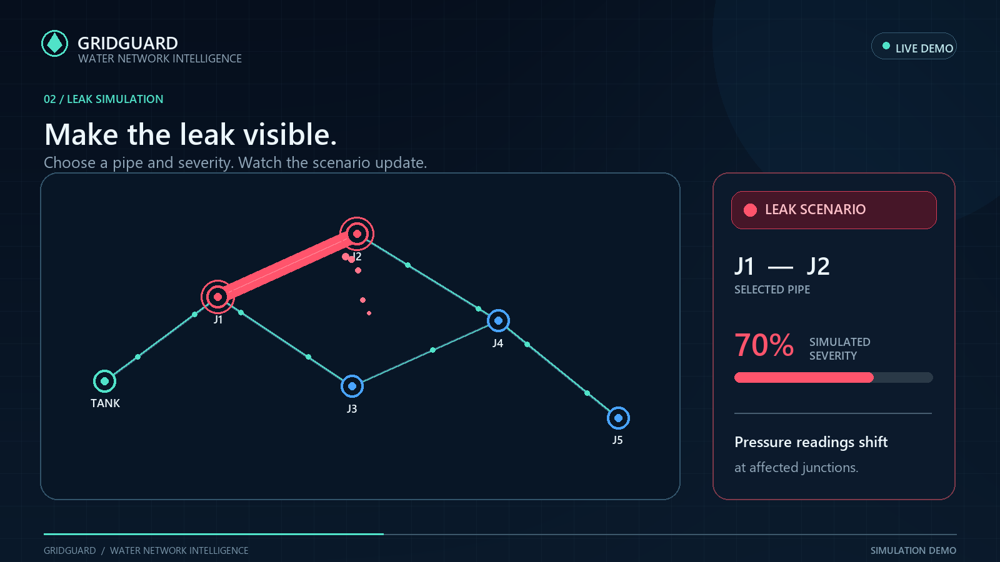

# GRIDGUARD 💧
### AI-Powered Water Pipeline Monitoring & Leak Detection Simulation

**Find the Hidden Leak. Reduce Water Loss. Protect Every Drop.**

GRIDGUARD is an interactive water-infrastructure monitoring prototype that combines pipeline simulation, sensor analytics, leak detection, optional OPC UA telemetry, dataset exploration, and **Google Gemini-powered AI diagnostics** in a unified dashboard.

Explore a virtual water distribution network, simulate pipeline leaks, observe pressure and flow changes, review detection results, and use AI-assisted explanations to better understand the current system state.

> **Prototype notice:** GRIDGUARD is an educational simulation, not a production water-management or safety system. It does not connect to physical sensors or utility infrastructure. Dashboard readings, pipeline conditions, and leak scenarios are simulated. AI-generated diagnostic explanations may be inaccurate and must not be used for operational decisions.

---

## 🚀 Key Features

### 🗺️ Interactive Pipeline Network
- Explore a virtual water distribution network with six junctions and six pipe segments.
- Select a pipe and configure a simulated leak scenario.
- Visualize affected pipeline segments and junctions.
- Observe changes in simulated pressure, flow, and network status.

### 💧 Leak Simulation & Detection
- Configure the target pipe and leak severity.
- Run and reset simulated leak scenarios interactively.
- Review pressure readings, network conditions, and detection results.
- Compare simulated conditions to understand potential leak indicators.
- Inspect the baseline pressure-threshold detection results.

### 🤖 Gemini-Powered AI Diagnostics
GRIDGUARD integrates the **Google Gemini API** to provide AI-assisted explanations of the dashboard state.

- Request explanations of simulated pipeline conditions.
- Ask diagnostic questions about potential leaks and abnormal readings.
- Interpret pressure and flow information in a more accessible format.
- Get contextual guidance based on information provided to the diagnostic endpoint.

AI output is advisory and experimental. It does not replace a validated leak-detection model, professional engineering judgment, or real-world sensor data.

**Configuration:** Set the `GEMINI_API_KEY` environment variable on the server. Never place a real API key in frontend JavaScript, HTML files, or a public repository.

### 📊 Live Dashboard
- View simulated pressure and flow readings.
- Monitor pipeline status indicators and events.
- Inspect leak-detection results and network information.
- Navigate between the project overview, dashboard, and supporting data views.

### 🔌 OPC UA / SCADA Demonstration
- Run an optional local OPC UA simulator using `asyncua`.
- Expose sample telemetry through a simulated OPC UA endpoint.
- Use the Flask backend to retrieve simulator status and readings.
- See when the optional simulator is unavailable.

This is a demonstration of industrial communication concepts, not a connection to real SCADA equipment.

### 🧪 LeakDB Dataset Preview
- Explore the bundled LeakDB Scenario 6 labels and sample sensor readings.
- Preview selected CSV data through the dashboard.
- Examine the difference between bundled benchmark data and the application's independently generated simulation.

The included dataset preview is separate from the live simulated network.

### 🌐 Project Overview & Dashboard
- Explore the project introduction and its key capabilities.
- Launch the main dashboard directly from the overview page.
- Navigate the simulation, telemetry, dataset, and diagnostic features from one interface.

---

## 🎬 Project Walkthrough

Watch the 36-second visual demonstration of GRIDGUARD's pipeline visualization and core features.

## 🎬 GRIDGUARD Project Demo

<p align="center">
  <a href="GRIDGUARD/assets/GRIDGUARD-project-demo.mp4">
    
  </a>
  <br>
  <strong>▶ Click the poster to watch the GRIDGUARD demo</strong>
</p>

*Format: MP4 · 1600 × 900 · H.264/AAC*

The walkthrough uses simulated values and demonstrates the prototype rather than a real infrastructure feed.

---

## 🛠️ Technology Stack

| Technology | Purpose |
|---|---|
| Python | Application logic and simulation |
| Flask | Backend server and REST API |
| Google Gemini API | AI-assisted diagnostic explanations |
| NetworkX | Virtual pipeline network representation |
| NumPy & pandas | Numerical operations and dataset processing |
| asyncua | OPC UA simulator and client communication |
| HTML, CSS & JavaScript | Interactive frontend and dashboard |
| CSV / LeakDB sample data | Dataset preview and exploration |

---

## ⚙️ Run Locally

### 1. Prerequisites

Install the following:

- Python 3.10 or a compatible version supported by the installed dependencies.
- Git.
- A modern web browser.
- A Google Gemini API key if you want to use the AI diagnostic feature.

### 2. Clone the repository

Open PowerShell and run:

```powershell
git clone https://github.com/Amit-Mavinakatti/gridguard-ai.git
cd gridguard-ai
```

### 3. Create a virtual environment

```powershell
py -m venv .venv
.\.venv\Scripts\Activate.ps1
```

If PowerShell blocks environment activation, run the environment's Python directly instead:

```powershell
.\.venv\Scripts\python.exe -m pip install -r requirements.txt
```

### 4. Install dependencies

```powershell
python -m pip install --upgrade pip
python -m pip install -r requirements.txt
```

### 5. Configure Gemini AI

Set your API key in the current PowerShell session:

```powershell
$env:GEMINI_API_KEY = "YOUR_GEMINI_API_KEY"
```

Replace the placeholder with your actual key. Obtain a key through [Google AI Studio](https://aistudio.google.com/).

Keep the key private. Do not commit it to GitHub or embed it in client-side code.

The key is available to processes launched from this PowerShell session. For persistent or deployed configuration, use the appropriate environment-variable settings.

### 6. Start GRIDGUARD

```powershell
python main.py
```

Open the project overview:

**http://127.0.0.1:5000/**

Or open the dashboard directly:

**http://127.0.0.1:5000/dashboard.html**

The Gemini diagnostic feature requires a valid API key and a compatible configured Gemini model. Other features may remain available if AI diagnostics cannot be reached, depending on the application's error handling.

---

## 🔌 Optional: Run the OPC UA Simulator

The OPC UA simulator is a separate process.

Open a second PowerShell window and run:

```powershell
cd "C:\path\to\gridguard-ai"
.\.venv\Scripts\Activate.ps1
python scada_simulator.py
```

The example endpoint is:

```text
opc.tcp://127.0.0.1:4840/gridguard/
```

Replace the example directory with your actual project path.

Keep the simulator running while testing the dashboard's SCADA panel. If it is stopped or unreachable, SCADA telemetry may appear as unavailable; the rest of the application can continue to work where fallback handling is implemented.

**Deployment note:** `127.0.0.1` refers to the machine running the process. When GRIDGUARD is hosted on Vercel, it refers to the serverless execution environment, not your personal laptop. A simulator running locally on your computer is therefore not directly reachable by the deployed application.

---

## 🧭 How to Use the Dashboard

1. Open **Pipeline Network** to explore the virtual network.
2. Select a pipe in the leak simulator.
3. Configure the leak severity and run **Simulate leak**.
4. Inspect highlighted segments, affected junctions, pressure and flow changes, and detection results.
5. Open **Live SCADA** to check telemetry from the optional local OPC UA simulator.
6. Visit **SCADA & datasets** to preview the bundled CSV data.
7. Use the **Gemini AI diagnostic feature** to request an explanation of the available dashboard context.
8. Select **Reset network** to clear the active simulated leak.

Actual navigation labels and available controls depend on the version deployed.

---

## 🔗 API Reference

The Flask backend exposes the following endpoints.

| Method | Endpoint | Purpose |
|---|---|---|
| `GET` | `/api/health` | Check API availability |
| `GET` | `/api/dashboard` | Retrieve network, telemetry, and detection information |
| `GET` | `/api/scada` | Retrieve OPC UA simulator status and telemetry |
| `GET` | `/api/datasets` | List bundled datasets |
| `POST` | `/api/dataset` | Load a CSV preview by filename |
| `POST` | `/api/simulate-leak` | Run a simulated leak scenario |
| `POST` | `/api/reset` | Reset the active leak scenario |
| `POST` | `/api/ai-diagnose` | Request an AI-assisted diagnostic explanation |

The request payloads and response formats are defined by the corresponding Flask routes in `backend/app.py`.

### Quick API checks

With the local application running, open these URLs in your browser:

- [API health](http://127.0.0.1:5000/api/health)
- [Dashboard data](http://127.0.0.1:5000/api/dashboard)
- [SCADA status](http://127.0.0.1:5000/api/scada)

The diagnostic and other `POST` endpoints require appropriate request bodies and should be tested using the formats expected by the backend.

---

## ☁️ Deployment

GRIDGUARD can be prepared for deployment on Vercel using its Python/Flask support.

1. Push the project to the `gridguard-ai` GitHub repository.
2. Import the repository into [Vercel](https://vercel.com/).
3. Configure the project using the repository root and the supplied Vercel configuration.
4. Add `GEMINI_API_KEY` under the project's environment variables.
5. Deploy and test the application and API routes.
6. Verify that the AI diagnostic endpoint works with the configured model and that failures are handled appropriately.

### Deployment considerations

- Never expose Gemini credentials to the browser or commit them to the repository.
- Serverless environments may have execution-time and dependency limitations.
- A laptop-local OPC UA endpoint will not automatically be accessible from Vercel.
- Validate every API route in the deployed environment; a successful page load does not guarantee every backend feature works.
- If you need remote OPC UA telemetry, configure a separately hosted and appropriately secured service rather than exposing a local simulator without access controls.

---

## 📁 Project Structure

```text
gridguard-ai/
├── assets/
│   ├── GRIDGUARD-project-demo-poster.png
│   └── GRIDGUARD-project-demo.mp4
├── backend/
│   └── app.py
├── data/
│   └── LeakDB_Scenario6_Labels.csv
├── detection/
│   └── leak_detector.py
├── frontend/
│   ├── index.html
│   ├── dashboard.html
│   └── about.html
├── simulation/
│   ├── pipeline.py
│   ├── leak_simulator.py
│   └── sensor_simulator.py
├── dataset_loader.py
├── main.py
├── requirements.txt
├── pyproject.toml
├── scada_bridge.py
├── scada_client.py
├── scada_simulator.py
└── README.md
```

*The tree illustrates the intended organization. Adjust filenames in the README if your final repository uses different names.*

---

## 📚 Data & Attribution

GRIDGUARD includes a small LeakDB Scenario 6 label file for demonstration and dataset-preview purposes. The bundled file is not the same as the application's live simulation output.

LeakDB is a research benchmark for leakage diagnosis in water distribution networks. Refer to the original project for the dataset, its terms, and the appropriate attribution requirements.

**Reference**

Vrachimis, S. G., Kyriakou, M. S., Eliades, D. G., & Polycarpou, M. M. (2018). *LeakDB: A benchmark dataset for leakage diagnosis in water distribution networks.* Proceedings of the WDSA/CCWI Joint Conference.

- [LeakDB source repository](https://github.com/KIOS-Research/LeakDB)
- [DOI record](https://doi.org/10.5281/zenodo.1313116)

---

## ⚠️ Current Limitations

- Pipeline readings and leak scenarios are simulated rather than measured from physical infrastructure.
- The baseline leak detector uses a simple pressure-threshold approach and is not an independently validated AI detection model.
- Gemini provides AI-assisted explanations; it does not establish that a leak exists or independently validate the detector's output.
- AI responses depend on the supplied context, model behavior, API availability, and configuration.
- The optional OPC UA simulator is intended for local demonstration and does not connect to real SCADA equipment.
- The included dataset preview is limited and does not establish real-world detection accuracy.
- Leak-localization confidence, measured accuracy, production readiness, and field performance have not been established.

---

## 🔮 Future Improvements

Potential extensions include:

- More robust anomaly-detection and leak-localization algorithms.
- Historical telemetry visualization and trend analysis.
- Expanded benchmark datasets and reproducible evaluation metrics.
- Better fault handling and observability for AI-assisted diagnostics.
- Secure remote telemetry integration.
- Automated testing and continuous deployment.

These are potential enhancements, not claims about currently implemented functionality.

---

## 👨‍💻 About the Project

GRIDGUARD explores how interactive simulation, network visualization, sensor analytics, industrial communication concepts, and generative AI can work together to make water-pipeline monitoring easier to understand.

The project is intended for learning, experimentation, and demonstration. It highlights both the potential of AI-assisted infrastructure analysis and the importance of distinguishing simulated results from validated real-world measurements.

**GRIDGUARD — Smarter Insights for Every Drop.**

---

*Built with Python, Flask, JavaScript, NetworkX, and Google Gemini API.*
